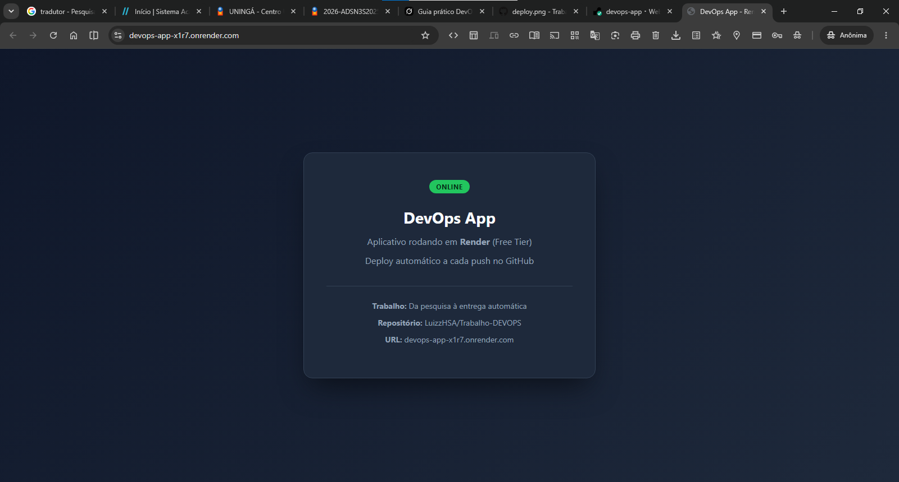

# 07 – Publicar o app manualmente

## Objetivo
Registrar o processo de publicação manual (primeiro deploy) antes de confiar totalmente no deploy automático.

## Passo a passo manual completo

1. Acessar https://render.com e fazer login com GitHub
2. Clicar em **New +** → **Web Service**
3. Selecionar o repositório `LuizzHSA/Trabalho-DEVOPS`
4. Configurar:
   - Name: `devops-app`
   - Root Directory: `app`
   - Runtime: Node
   - Build Command: `npm install`
   - Start Command: `node server.js`
   - Instance Type: Free
5. Clicar em **Create Web Service**
6. Aguardar o build e o deploy
7. Acessar a URL gerada

## Como o app sobrevive a reinícios

O Render gerencia o ciclo de vida do container. Mesmo que o serviço durma (cold start), ele é reativado automaticamente na próxima requisição. Não é necessário pm2 ou systemd.

## Endereço público

**https://devops-app-x1r7.onrender.com/**

## Evidências

## Fontes consultadas
- Documentação do Render
- Uso de IA: Grok (xAI)

## Conclusão do capítulo
O aplicativo foi publicado com sucesso e está acessível publicamente. O processo manual foi compreendido e documentado.
