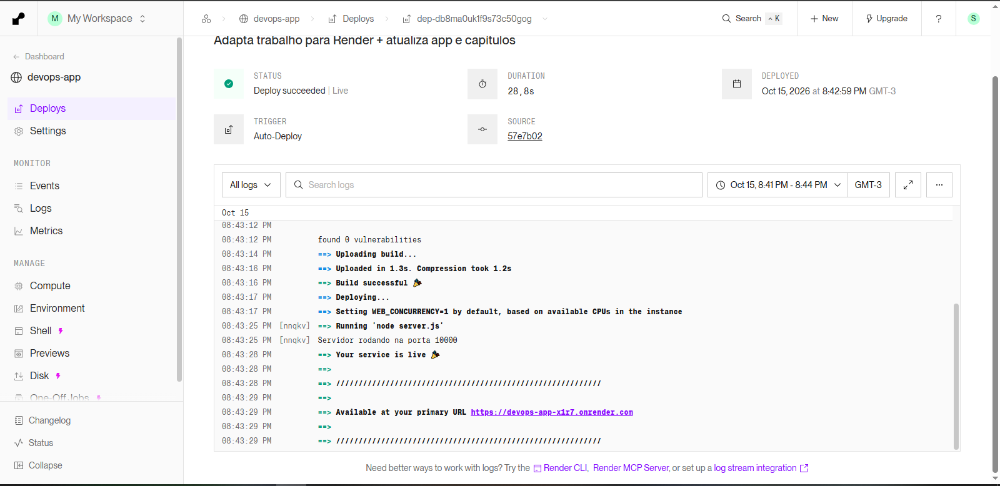

# 08 – Montar o CI/CD com GitHub + Render

## Objetivo
Configurar o deploy automático de forma que todo push na branch main atualize o aplicativo no Render sem intervenção manual.

## Link do repositório
[https://github.com/LuizzHSA/Trabalho-DEVOPS](https://github.com/LuizzHSA/Trabalho-DEVOPS)

## Diagrama do fluxo

```text
Desenvolvedor
     |
  git push (main)
     |
     v
GitHub Repository
     |
     v
Render (auto-deploy ativado)
     |
     +---> Build (npm install)
     +---> Start (node server.js)
     |
     v
App atualizado em produção
https://devops-app-x1r7.onrender.com/
```

## Como o CI/CD funciona no Render

O Render possui integração nativa com GitHub. Ao conectar o repositório e ativar o **Auto-Deploy**, qualquer push na branch configurada dispara automaticamente:

1. Clone do código
2. Execução do Build Command
3. Execução do Start Command
4. Substituição da versão anterior

Não foi necessário criar workflow manual no `.github/workflows` para o deploy principal, pois o próprio Render faz esse papel.

## Segredos e proteção

- A conexão é feita via OAuth do GitHub
- O Render só tem acesso ao repositório autorizado
- Não há chaves SSH expostas no repositório

## Evidências


## Fontes consultadas
- Documentação do Render (Auto-Deploy)
- Uso de IA: Grok (xAI)

## Conclusão do capítulo
O pipeline de CI/CD está funcionando. Qualquer alteração enviada para a branch main é automaticamente publicada no Render.
